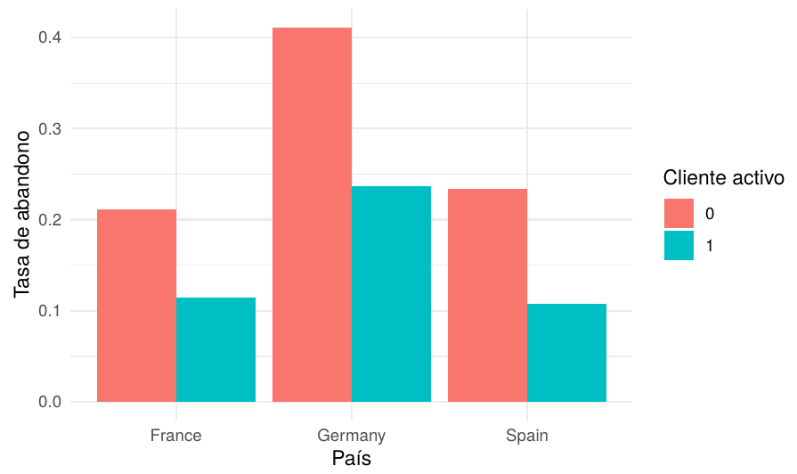
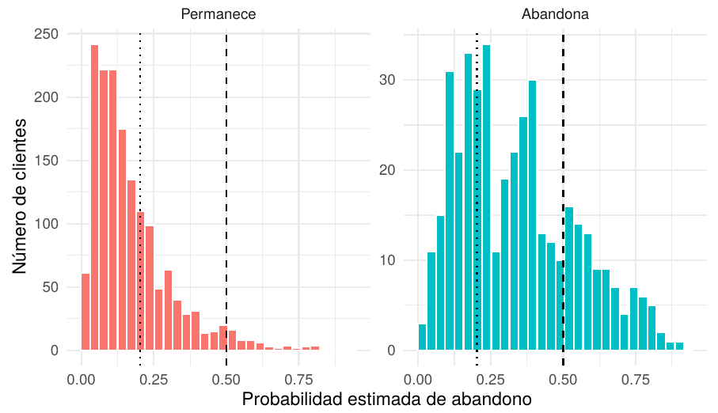
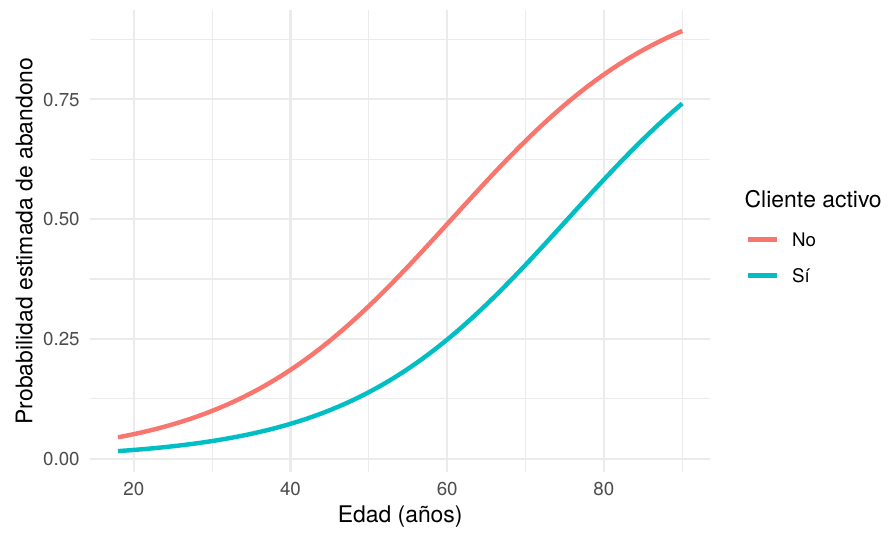
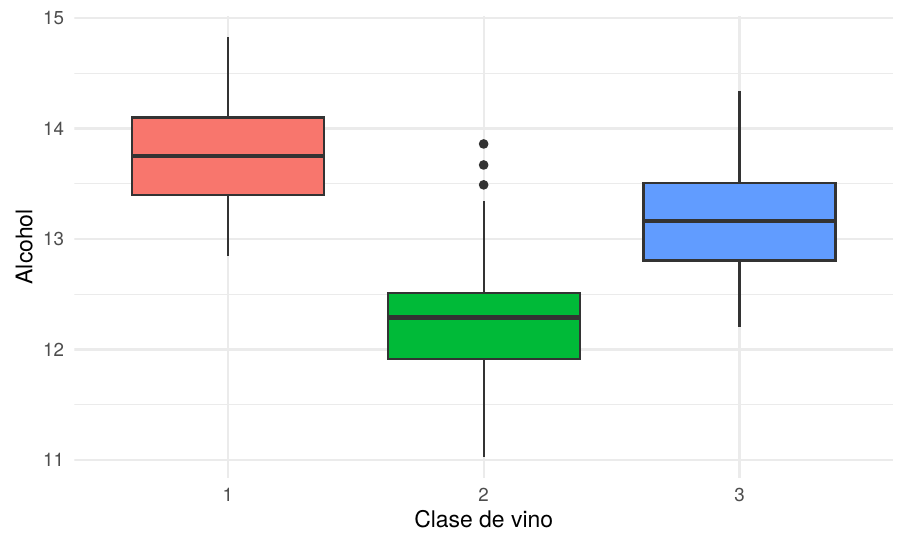
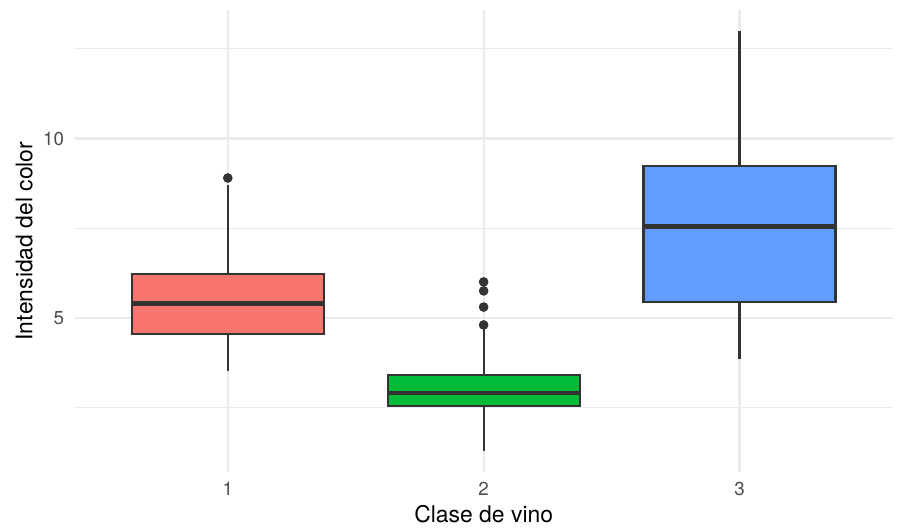
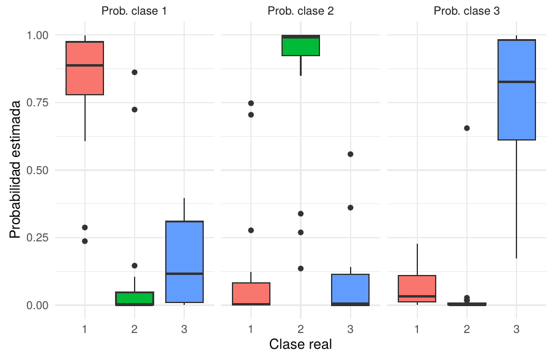
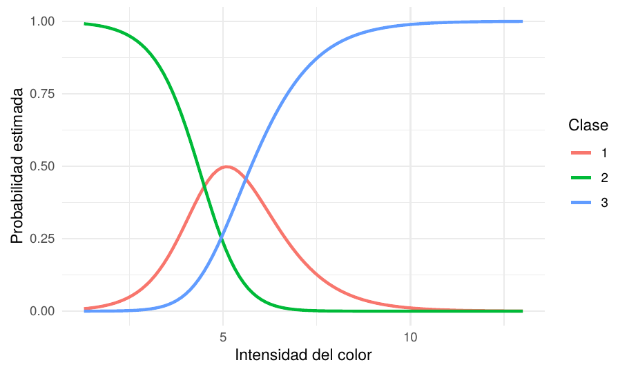
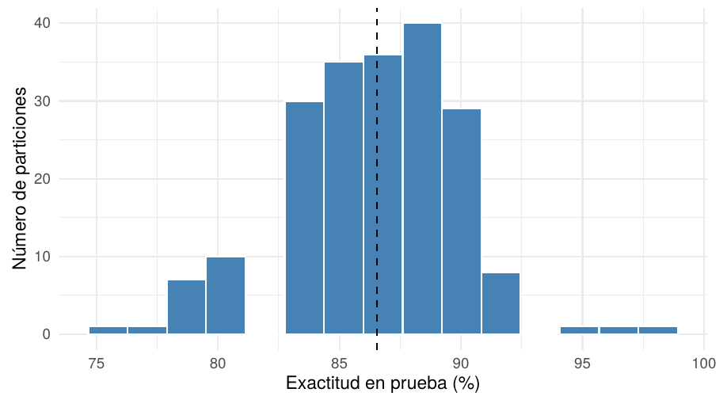

<h1 align="center">📊 Modelos Lineales Generalizados en Python</h1> <p align="center">     </p> <p align="center"> Este proyecto aplica modelos lineales generalizados en Python (<code>statsmodels</code>, <code>scikit-learn</code>, <code>pandas</code> y <code>seaborn</code>) para responder dos preguntas: qué factores se asocian con el abandono de clientes de un banco (regresión logística binaria) y qué características químicas permiten diferenciar tres clases de vino (regresión logística multinomial). Los datos provienen de <em>Bank Customer Churn Prediction</em> (Kaggle): 10.000 clientes de Francia, Alemania y España, y de <em>Wine</em> (UCI Machine Learning Repository): 178 vinos de tres cultivares italianos. </p> <p align="center"> <a href="https://www.kaggle.com/search?q=Churn_Modelling.csv">Dataset: abandono de clientes</a> · <a href="https://archive.ics.uci.edu/dataset/109/wine">Dataset: vinos</a> </p>

## 🎯 Problema de Negocio y Objetivos

El proyecto aplica modelos lineales generalizados en Python (`statsmodels` y `scikit-learn`) a dos problemas distintos: uno de negocio bancario y uno de clasificación de productos.

### Ejercicio 1. Abandono de clientes (regresión logística binaria)

Un banco quiere entender por qué se van sus clientes. A partir de `Churn_Modelling.csv` (10.000 clientes de Francia, Alemania y España), el análisis busca responder:

1. **Factores del abandono:** ¿Qué características (edad, país, género, saldo, actividad) se asocian con una mayor probabilidad de abandonar el banco, y cuánto cambian los momios de abandono por cada una?
2. **Capacidad de detección:** Como solo una minoría de clientes abandona, ¿cuántos abandonos detecta realmente el modelo y qué se gana o se pierde al cambiar el umbral de clasificación?

### Ejercicio 2. Tipos de vino (regresión logística multinomial)

Una empresa vinícola quiere saber qué características químicas distinguen sus tres clases de vino. A partir de `wine.data` (178 vinos), el análisis busca responder:

1. **Diferenciación de clases:** ¿Qué tan bien permiten el alcohol, el ácido málico y la intensidad del color distinguir las tres clases, y cómo se comparan las clases 2 y 3 frente a la clase 1?
2. **Estabilidad del modelo:** Con solo 178 vinos, ¿cambian mucho la exactitud y el sentido de los efectos si se repite la partición entre entrenamiento y prueba?

## 📁 Estructura del repositorio

```text
modelos-lineales-generalizados-Python/
├── Data/            
│   ├── Churn_Modelling.csv 
│   └── wine.data       
├── Actividad.pdf          
├── analisis_mlg.ipynb     
├── requirements.txt
├── Imagenes/    
└── README.md              
```
> **Nota:** el cuaderno lee los datos desde la carpeta `Data`, que debe estar junto a `analisis_mlg.ipynb`. Si `wine.data` no está, se descarga de UCI.
>
> ## 📌 Vistazo a los Principales Hallazgos

### Ejercicio 1. Abandono de clientes

| Hallazgo | Resultado | Lectura |
|:---|:---:|:---|
| Tasa de abandono | 20,4 % | Clase minoritaria: 2.037 de 10.000 clientes |
| Edad | OR 1,075 por año | Cada año adicional aumenta 7,5 % los momios de abandono; quienes abandonan tienen en promedio 44,8 años frente a 37,4 |
| Cliente activo | OR 0,345 | Los clientes activos tienen 65,5 % menos momios de abandonar |
| Alemania vs. Francia | OR 2,383 | Los momios son 138,3 % mayores; la tasa de abandono es 32,4 % frente a 16,2 % |
| Mujeres vs. hombres | OR 1,616 | Los momios de abandono son 61,6 % mayores |
| Exactitud en prueba (umbral 0,50) | 81,0 % | Apenas supera el 79,2 % de predecir siempre "no abandona" |
| Sensibilidad / especificidad (umbral 0,50) | 22,9 % / 96,2 % | El modelo deja sin detectar a la mayoría de los clientes que se van |
| Sensibilidad / especificidad (umbral 0,20) | 68,9 % / 70,5 % | Al bajar el umbral se detectan más abandonos, a costa de más falsas alarmas |

<p align="center">
  
  
</p>

<p align="center">
  
</p>

### Ejercicio 2. Tipos de vino

| Hallazgo | Resultado | Lectura |
|:---|:---:|:---|
| Exactitud en prueba | 86,8 % | 46 de 53 vinos bien clasificados; por clase: 88,9 %, 85,7 % y 85,7 % |
| Intensidad del color, clase 3 vs. 1 | RRR 2,773 | Cada unidad adicional de color aumenta 177,3 % los momios de ser clase 3 |
| Alcohol, clase 2 vs. 1 | RRR 0,013 | Más alcohol hace mucho menos probable la clase 2 frente a la 1 |
| Ácido málico, clase 3 vs. 1 | RRR 5,685 | Cada unidad adicional multiplica por 5,7 los momios de ser clase 3 |
| Estabilidad de la exactitud (200 particiones) | 86,5 % ± 3,6 | El 95 % central de las particiones va de 79,2 % a 92,5 % |
| Estabilidad de los efectos | 100 % mismo signo, salvo uno | Solo el ácido málico en la clase 2 cambia de signo (66,5 %) |

<p align="center">
  
  
</p>

<p align="center">
  
  
</p>

<p align="center">
  
</p>

> **Conclusión:** la edad, la actividad del cliente y el país explican bien quién abandona, pero con un umbral de 0,50 el modelo detecta pocos abandonos. En los vinos, la intensidad del color y el alcohol separan bien las tres clases; con solo 178 vinos, la exactitud es un rango y no un valor único, y el efecto del ácido málico en la clase 2 no es confiable.
