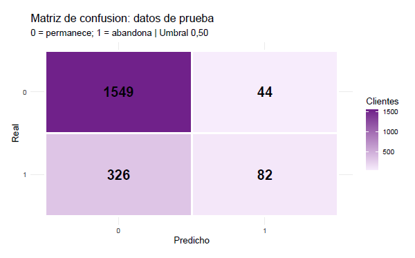
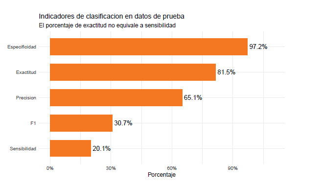
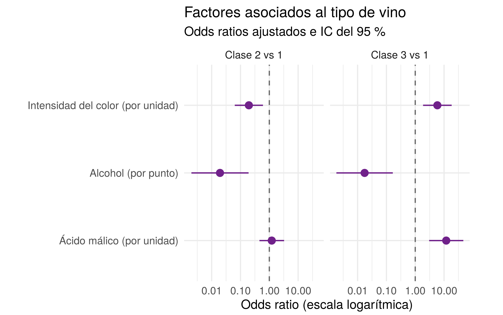
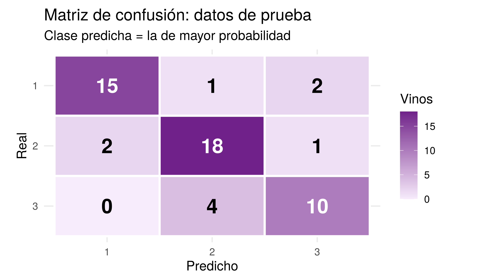
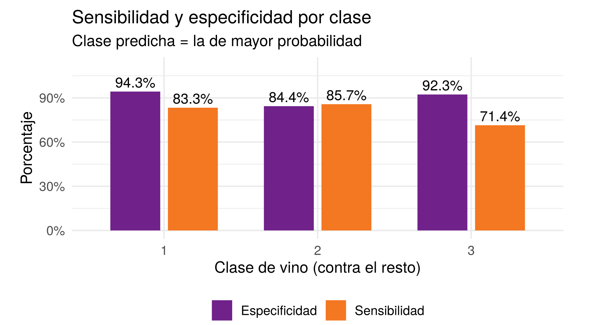

<h1 align="center">📊 Modelos Lineales Generalizados de Regresión Logística</h1>

<div align="center">


</div>

<p align="center">
  Este proyecto aplica modelos lineales generalizados en Python (<code>statsmodels</code>, <code>scikit-learn</code>, <code>pandas</code> y <code>seaborn</code>) para responder dos preguntas: qué factores se asocian con el abandono de clientes de un banco (regresión logística binaria) y qué características químicas permiten diferenciar tres clases de vino (regresión logística multinomial).
</p>

<p align="center">
  <a href="https://www.kaggle.com/search?q=Churn_Modelling.csv">Dataset: abandono de clientes</a> ·
  <a href="https://archive.ics.uci.edu/dataset/109/wine">Dataset: vinos</a>
</p>


## 📁 Estructura del repositorio

```text
modelos-lineales-generalizados-Python/
├── Enunciados_casos.pdf
├── Row_Data/            
│   ├── Churn_Modelling.csv 
│   └── wine.data                 
├── Analisis_Python/ 
│   ├── 01_Analisis_Banco.ipynb
│   └── 02_Analisis_Vino.ipynb
├── Informes_R_Markdown/
│   ├── 01_Informe_Caso1.pdf
│   └── 02_Informe_Caso2.pdf
├── Imagenes/    
└── README.md              
```


## Caso 1. Abandono de clientes (regresión logística binaria)


### ❓ ¿Por qué se eligió este modelo?
La regresión logística fue seleccionada deliberadamente como una línea base (baseline) tanto en lo metodológico como en lo analítico. Al tratarse de una simulación orientada a sentar las bases en Machine Learning, este enfoque permite priorizar la interpretabilidad total, facilitando la cuantificación directa del impacto de cada variable en el riesgo de abandono. Asimismo, este ejercicio sirve como punto de partida para dominar los fundamentos estadísticos y el flujo de trabajo de clasificación supervisada antes de explorar algoritmos de mayor complejidad.

### Enfoque utilizado

Se analizaron 10.000 registros de clientes bancarios mediante Python, aplicando un modelo de regresión logística. Para su desarrollo y evaluación, los datos se dividieron de forma estratificada en dos conjuntos: 80 % para el entrenamiento del modelo y 20 % para evaluar su capacidad predictiva.

### 📊 Solución desarrollada

Se construyó un prototipo analítico de regresión logística que estima probabilidades individuales de abandono y permite interpretar el efecto de cuatro variables predictoras: edad, saldo, actividad del cliente y país.


#### Factores asociados al abandono


Interpretación: Vivir en Alemania, tener mayor edad y un mayor saldo se asocian con mayores odds de abandono, mientras que ser cliente activo los reduce (OR ≈ 0,33). No hay diferencias significativas entre España y Francia (la raya cruza el 1). La devianza bajó cerca de un 14,4 % frente al modelo nulo (pseudo-R² de McFadden = 0,144).

#### Matriz de confusión en datos de prueba
<p align="center">  </p>

Interpretación: Con un umbral de 0,50, el modelo clasificó bien a 1.549 clientes que permanecieron y detectó 82 abandonos, pero dejó escapar 326 abandonos y generó 44 falsas alarmas.

#### Indicadores de clasificación
<p align="center">  </p>

Interpretación: El modelo tiene una exactitud del 81,5 % y una especificidad del 97,2 %, es decir, identifica muy bien a quienes permanecen. Sin embargo, su sensibilidad es de solo 20,1 %, por lo que ne

### 📊 Resultados principales

- La actividad del cliente, la edad y el país de residencia constituyen factores relevantes para identificar perfiles asociados al abandono bancario.
- Aunque el modelo presenta una exactitud global del 81,5 %, tiene dificultades para detectar a los clientes que efectivamente abandonan el banco.
- El modelo identifica adecuadamente a los clientes que permanecen, pero requiere mejorar su sensibilidad para detectar oportunamente posibles abandonos.

### ✅ Validación y mejora

**¿Cómo validamos y mejoramos?**
La evaluación se realizó sobre 2.001 observaciones de prueba, no utilizadas en el ajuste. El modelo identificó correctamente el 97,2 % de los clientes que permanecieron, pero solo el 20,1 % de quienes abandonaron. Se requiere mejorar la detección de abandonos antes de considerar su aplicación operativa.

### 🚀 Proyección

**¿Qué sigue?**
Se propone evaluar nuevos predictores, comparar umbrales de clasificación mediante validación cruzada y mejorar la sensibilidad sin comprometer excesivamente la precisión. Posteriormente, se podría explorar una herramienta de apoyo a estrategias de retención.


## Caso 2. Tipos de vino (regresión logística multinomial)


### Enfoque utilizado

Se analizaron 178 vinos de un conjunto de datos didáctico (*Wine*, repositorio UCI) mediante R Markdown, aplicando un modelo de regresión logística multinomial con la clase 1 como referencia. Para su desarrollo y evaluación, los datos se dividieron de forma estratificada por clase en dos conjuntos: 70 % para el entrenamiento (125 vinos) y 30 % para evaluar su capacidad predictiva (53 vinos).

### 🛠️ Solución desarrollada

Se construyó un prototipo analítico que estima, para cada vino, la probabilidad de pertenecer a cada una de las tres clases a partir de tres variables químicas: contenido de alcohol, ácido málico e intensidad del color. Además de la exactitud, se evaluó el desempeño con la sensibilidad y la especificidad de cada clase (clase contra el resto), curvas ROC y una comparación de umbrales de clasificación.

#### Factores asociados a la clase de vino
<p align="center">  </p>

Interpretación: Una mayor intensidad del color y un mayor nivel de ácido málico se asocian con mayores odds de pertenecer a la clase 3 frente a la clase 1 (OR ≈ 5,9 y ≈ 11,9, respectivamente), mientras que un mayor contenido de alcohol reduce los odds de pertenecer a la clase 2 o a la 3 (OR ≈ 0,02 por punto de alcohol). El ácido málico no es significativo para distinguir la clase 2 de la 1 (p = 0,698). El modelo ajusta mucho mejor que uno sin predictores (pseudo-R² de McFadden = 0,78).

#### Matriz de confusión en datos de prueba
<p align="center">  </p>

Interpretación: De los 53 vinos de prueba, el modelo clasificó correctamente 43 (15 de la clase 1, 18 de la clase 2 y 10 de la clase 3). La confusión más frecuente fue clasificar como clase 2 a vinos que realmente eran de la clase 3 (4 casos).

#### Sensibilidad y especificidad por clase
<p align="center">  </p>

Interpretación: El modelo alcanzó una exactitud del 81,1 %, frente a 39,6 % de predecir siempre la clase más frecuente. La sensibilidad fue de 83,3 %, 85,7 % y 71,4 % para las clases 1, 2 y 3, y la especificidad de 94,3 %, 84,4 % y 92,3 %. La clase 3 es la más difícil de detectar. Los AUC de las tres clases (clase contra el resto) estuvieron entre 0,94 y 0,97.

### 📊 Resultados principales

- La intensidad del color, el contenido de alcohol y el ácido málico permiten diferenciar los tres tipos de vino con una exactitud del 81,1 % en datos de prueba.
- La clase 3 presenta la menor sensibilidad (71,4 %): casi 3 de cada 10 vinos de esa clase no se identifican como tal.
- El ácido málico aporta sobre todo para identificar la clase 3; para distinguir la clase 2 de la 1 no es significativo.

### ✅ Validación y mejora

**¿Cómo validamos y mejoramos?**
La evaluación se realizó sobre 53 vinos de prueba, no utilizados en el ajuste. Como una sola partición puede ser engañosa, se repitió 200 veces la partición estratificada: la exactitud promedio fue de 86,5 % (desviación estándar de 3,6 puntos), con un rango central del 95 % entre 79,2 % y 92,5 %. Por eso la exactitud debe reportarse como un rango, y no como un valor único. El signo de los coeficientes se mantuvo en todas las repeticiones, excepto en el ácido málico de la clase 2 (66,5 %), consistente con su falta de significancia.

También se compararon umbrales de clasificación (0,20 a 0,80): subir el umbral aumenta la especificidad y reduce la sensibilidad. Los umbrales "óptimos" elegidos solo con los datos de entrenamiento (índice de Youden) no mejoraron de forma consistente en prueba, lo que muestra que con pocos datos conviene validarlos con más cuidado.

### 🎓 Aprendizajes e impacto

- Comprender la diferencia entre el modelo binario y el multinomial: odds ratios frente a una categoría de referencia, y un vector de tres probabilidades por vino.
- Evaluar con sensibilidad y especificidad por clase (clase contra el resto), y no solo con la exactitud global.
- Entender que el umbral de clasificación intercambia sensibilidad por especificidad, y que debe elegirse con datos de entrenamiento y según el costo de cada error.
- Reconocer que, con muestras pequeñas, el resultado depende de la partición, por lo que se debe medir su estabilidad y reportar rangos.

### 🚀 Proyección

**¿Qué sigue?**
Se propone incorporar otras variables químicas (por ejemplo, flavonoides o prolina), probar regularización y seleccionar el umbral mediante validación cruzada dentro del entrenamiento, reservando la prueba para la evaluación final. Posteriormente, se podría comparar con algoritmos de mayor complejidad y explorar una herramienta de apoyo para la clasificación de vinos.

> **Conclusión:** la edad, la actividad del cliente y el país explican bien quién abandona, pero con un umbral de 0,50 el modelo detecta pocos abandonos. En los vinos, la intensidad del color y el alcohol separan bien las tres clases; con solo 178 vinos, la exactitud es un rango y no un valor único, y el efecto del ácido málico en la clase 2 no es confiable.

# Comparación final de los modelos

| Aspecto | Logístico binario | Logístico multinomial |
|:---|:---|:---|
| Número de categorías de respuesta | 2 (abandona / no abandona) | 3 (clases de vino 1, 2 y 3) |
| Categoría de referencia | No abandona (0); se modela la probabilidad del evento 1 | Clase 1; las clases 2 y 3 se comparan contra ella |
| Interpretación de coeficientes | Un solo conjunto de coeficientes; exp(coef) es el OR del abandono frente a la permanencia | Un conjunto de coeficientes por cada clase frente a la referencia; exp(coef) es la razón de momios de esa clase frente a la clase 1 |
| Tipo de probabilidades estimadas | Una probabilidad, P(abandono), con P(no abandono) = 1 - P | Un vector de tres probabilidades que suma 1; se clasifica en la de mayor valor |

Nota : Los datos trabajados provienen de <em>Bank Customer Churn Prediction</em> (Kaggle): 10.000 clientes de Francia, Alemania y España, y de <em>Wine</em> (UCI Machine Learning Repository): 178 vinos de tres cultivares italianos.

