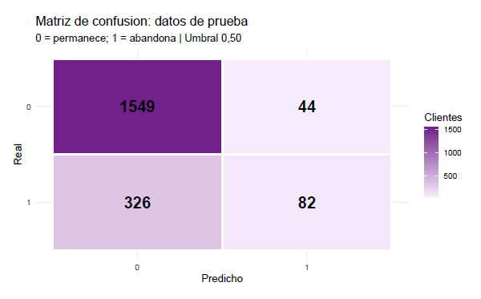
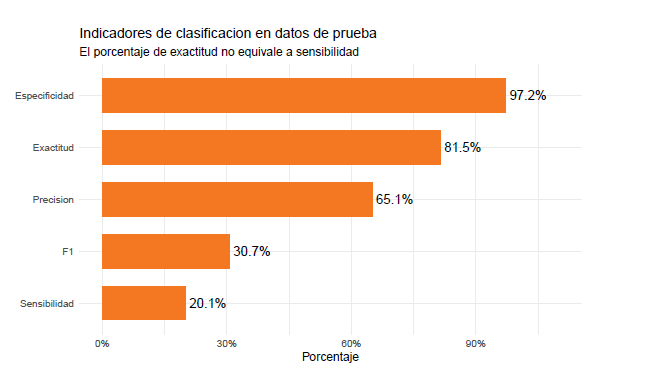

<h1 align="center">📊 Modelos Lineales Generalizados para Clasificación</h1>

<div align="center">


</div>

<p align="center">
  Este proyecto aplica modelos lineales generalizados en Python (<code>statsmodels</code>, <code>scikit-learn</code>, <code>pandas</code> y <code>seaborn</code>) para responder dos preguntas: qué factores se asocian con el abandono de clientes de un banco (regresión logística binaria) y qué características químicas permiten diferenciar tres clases de vino (regresión logística multinomial).
</p>

<p align="center">
  <a href="https://www.kaggle.com/search?q=Churn_Modelling.csv">Dataset: abandono de clientes</a> ·
  <a href="https://archive.ics.uci.edu/dataset/109/wine">Dataset: vinos</a>
</p>


## Caso 1. Abandono de clientes (regresión logística binaria)


### ❓ ¿Por qué se eligió este modelo?
La regresión logística fue seleccionada deliberadamente como una línea base (baseline) tanto en lo metodológico como en lo analítico. Al tratarse de una simulación orientada a sentar las bases en Machine Learning, este enfoque permite priorizar la interpretabilidad total, facilitando la cuantificación directa del impacto de cada variable en el riesgo de abandono. Asimismo, este ejercicio sirve como punto de partida para dominar los fundamentos estadísticos y el flujo de trabajo de clasificación supervisada antes de explorar algoritmos de mayor complejidad.

### Enfoque utilizado

Se analizaron 10.000 registros de clientes bancarios mediante Python, aplicando un modelo de regresión logística. Para su desarrollo y evaluación, los datos se dividieron de forma estratificada en dos conjuntos: 80 % para el entrenamiento del modelo y 20 % para evaluar su capacidad predictiva.

### 📊 Solución desarrollada

Se construyó un prototipo analítico de regresión logística que estima probabilidades individuales de abandono y permite interpretar el efecto de cuatro variables predictoras: edad, saldo, actividad del cliente y país.


#### Factores asociados al abandono


Interpretación: Vivir en Alemania, tener mayor edad y un mayor saldo se asocian con mayores odds de abandono, mientras que ser cliente activo los reduce (OR ≈ 0,33). No hay diferencias significativas entre España y Francia (la raya cruza el 1). La devianza bajó cerca de un 14,4 % frente al modelo nulo (pseudo-R² de McFadden = 0,144).

#### Matriz de confusión en datos de prueba
<p align="center">  </p>

Interpretación: Con un umbral de 0,50, el modelo clasificó bien a 1.549 clientes que permanecieron y detectó 82 abandonos, pero dejó escapar 326 abandonos y generó 44 falsas alarmas.

#### Indicadores de clasificación
<p align="center">  </p>

Interpretación: El modelo tiene una exactitud del 81,5 % y una especificidad del 97,2 %, es decir, identifica muy bien a quienes permanecen. Sin embargo, su sensibilidad es de solo 20,1 %, por lo que ne

### 📊 Resultados principales

- La actividad del cliente, la edad y el país de residencia constituyen factores relevantes para identificar perfiles asociados al abandono bancario.
- Aunque el modelo presenta una exactitud global del 81,5 %, tiene dificultades para detectar a los clientes que efectivamente abandonan el banco.
- El modelo identifica adecuadamente a los clientes que permanecen, pero requiere mejorar su sensibilidad para detectar oportunamente posibles abandonos.

### ✅ Validación y mejora

**¿Cómo validamos y mejoramos?**
La evaluación se realizó sobre 2.001 observaciones de prueba, no utilizadas en el ajuste. El modelo identificó correctamente el 97,2 % de los clientes que permanecieron, pero solo el 20,1 % de quienes abandonaron. Se requiere mejorar la detección de abandonos antes de considerar su aplicación operativa.

### 🚀 Proyección

**¿Qué sigue?**
Se propone evaluar nuevos predictores, comparar umbrales de clasificación mediante validación cruzada y mejorar la sensibilidad sin comprometer excesivamente la precisión. Posteriormente, se podría explorar una herramienta de apoyo a estrategias de retención.


## Caso 2. Tipos de vino (regresión logística multinomial)


<p align="center">
  
  
</p>

<p align="center">
  
  
</p>

<p align="center">
  
</p>

> **Conclusión:** la edad, la actividad del cliente y el país explican bien quién abandona, pero con un umbral de 0,50 el modelo detecta pocos abandonos. En los vinos, la intensidad del color y el alcohol separan bien las tres clases; con solo 178 vinos, la exactitud es un rango y no un valor único, y el efecto del ácido málico en la clase 2 no es confiable.


## 📁 Estructura del repositorio

```text
modelos-lineales-generalizados-Python/
├── Enunciado_casos_1y2.pdf
├── Data/            
│   ├── Churn_Modelling.csv 
│   └── wine.data                 
├── Analisis_Python/ 
│   ├── 01_Analisis_Banco 
│   └── 02_Analisis_Vino
├── Reportes/
│   ├── 01_Reporte_Caso1.pdf
│   └── 02_Reporte_Caso2.pdf
├── Imagenes/    
└── README.md              
```

Nota : Los datos trabajados provienen de <em>Bank Customer Churn Prediction</em> (Kaggle): 10.000 clientes de Francia, Alemania y España, y de <em>Wine</em> (UCI Machine Learning Repository): 178 vinos de tres cultivares italianos.

